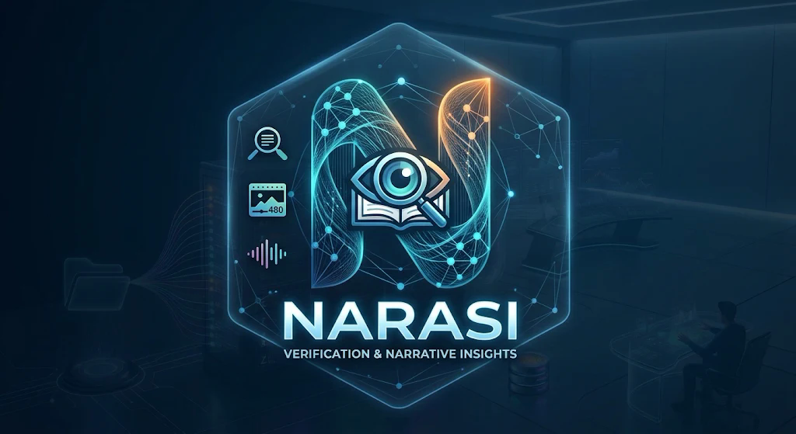

# Filosofi Logo NARASI

> **NARASI: jaga ruang kognitif TNI AD.**

## Kisah di balik nama

Perang hari ini nggak cuma terjadi di darat, laut, dan udara. Ada medan keempat: **ruang kognitif**, tempat
orang membentuk keyakinan dari apa yang mereka tonton. Di medan ini senjatanya adalah **narasi**: potongan video
latihan yang diberi caption "18.000 pasukan dikirim ke Aceh", suara yang dipotong dari konteksnya, atau teks di
layar yang nyelip di antara scroll.

Karena itu aplikasi ini diberi nama **NARASI**. Kami nggak melawan narasi dengan sensor. Kami melawannya dengan
**narasi tandingan yang berbasis bukti**: klaim dibaca, dicocokkan dengan sumber resmi, lalu diberi label yang
bisa dipertanggungjawabkan, langsung di layar tempat narasi itu beredar.

## Anatomi logo

Ikon kecil (ekstensi, dashboard, favicon) memakai bagian huruf N saja: [logo/narasi-ikon.png](logo/narasi-ikon.png).

### 1. Huruf **N** dari jaringan titik: narasi yang ditelusuri

**N** adalah inisial NARASI sekaligus simbol *narasi* itu sendiri. Hurufnya tidak digambar polos, tapi tersusun
dari **pita gelombang dan jaringan titik yang saling terhubung**. Begitulah narasi beredar di media sosial: satu
klaim menyambung ke unggahan ulang, potongan video, dan akun lain sampai membentuk jaring.

Bentuk N juga menggambarkan cara kerja aplikasinya:

- **Tiang kiri** adalah **klaim**: apa yang dikatakan video lewat caption, teks layar, dan suara.
- **Tiang kanan** adalah **sumber**: bantahan resmi Komdigi, PPID TNI AD, dan pemeriksa fakta.
- **Lengkung diagonal** adalah **jembatan verifikasi** yang menghubungkan keduanya.

### 2. Mata, kaca pembesar, dan buku terbuka: verifikasi berbasis bukti

Di tengah huruf N ada **mata** yang mengawasi, **kaca pembesar** yang memeriksa, dan **buku terbuka** sebagai
rujukan. Ketiganya merangkum prinsip NARASI: **lihat, periksa, lalu rujuk sumbernya**. Label *Indikasi Hoaks*
hanya keluar kalau ada bukti, dan setiap kesimpulan menyertakan tautan sumber yang bisa dicek sendiri.

### 3. Tiga ikon di sisi kiri: tiga sinyal yang dibaca

| Ikon | Sinyal | Yang dikerjakan NARASI |
|---|---|---|
| Kaca pembesar di atas dokumen | **Caption** | Mengambil pernyataan penting dari teks |
| Bingkai gambar bertanda 480 | **Teks di layar** | Membaca frame video (dikirim pada 480 px) |
| Gelombang suara | **Suara** | Mendengarkan dan mentranskripsi audio |

Inilah yang membedakan NARASI: hoaks yang ngumpet di layar atau suara tetap ketahuan.

### 4. Heksagon kaca: perisai kognitif

Bingkai **heksagon** adalah bentuk paling kokoh di alam, seperti sarang lebah, dan sering dipakai sebagai lambang
perisai. Di sini ia menjadi **tameng kognitif** yang menjaga ruang tempat orang membentuk keyakinan. Bingkainya
tembus pandang: NARASI menandai, **tidak menutupi atau menyensor** konten. Penonton tetap yang memutuskan.

### 5. Biru ke oranye: dari tenang ke waspada

Sebagian besar logo berwarna **biru sian**: tenang, dipercaya, dan berjaga, seperti pos jaga di malam hari. Di
ujung kanan atas huruf N, warnanya berubah jadi **oranye**: titik saat sistem menemukan sesuatu yang perlu
diwaspadai dan **peringatan dini** dikirim ke tim Penerangan sebelum narasi viral.

### 6. Tagline: *Verification & Narrative Insights*

NARASI tidak berhenti di label untuk penonton. Setiap pemeriksaan menjadi **wawasan narasi** bagi petugas di
dashboard: narasi mana yang sedang naik, seberapa cepat menyebar, dan tindakan apa yang disarankan.

## Palet warna dan maknanya

| Warna | Kode | Makna |
|---|---|---|
| Biru navy | latar | Kepercayaan, ketenangan, kesiagaan |
| Biru sian | `#38C6F4` | Jaringan narasi yang sedang ditelusuri; warna utama dashboard |
| Oranye | ujung huruf N | Titik waspada, saat peringatan dini menyala |
| Merah | `#FF5A5F` | Label Indikasi Hoaks di aplikasi |
| Hijau | `#3DD68C` | Label Didukung Sumber di aplikasi |
| Emas | `#F5C46B` | Kehormatan TNI AD: tag "Mencatut TNI" dan tombol "Laporkan ke TNI AD" |

Warna label di aplikasi dibuat tegas supaya langsung dipahami tanpa legenda: **merah berarti waspada, hijau berarti
ada bukti, emas berarti menyangkut TNI**.

## Ringkasan satu kalimat

> Logo NARASI adalah **jaringan narasi (N)** yang **diperiksa dengan bukti (mata, kaca pembesar, buku)** dari
> **tiga sinyal (caption, layar, suara)**, dijaga oleh **perisai heksagon** yang tenang dan menyala oranye saat
> ada yang perlu diwaspadai.
